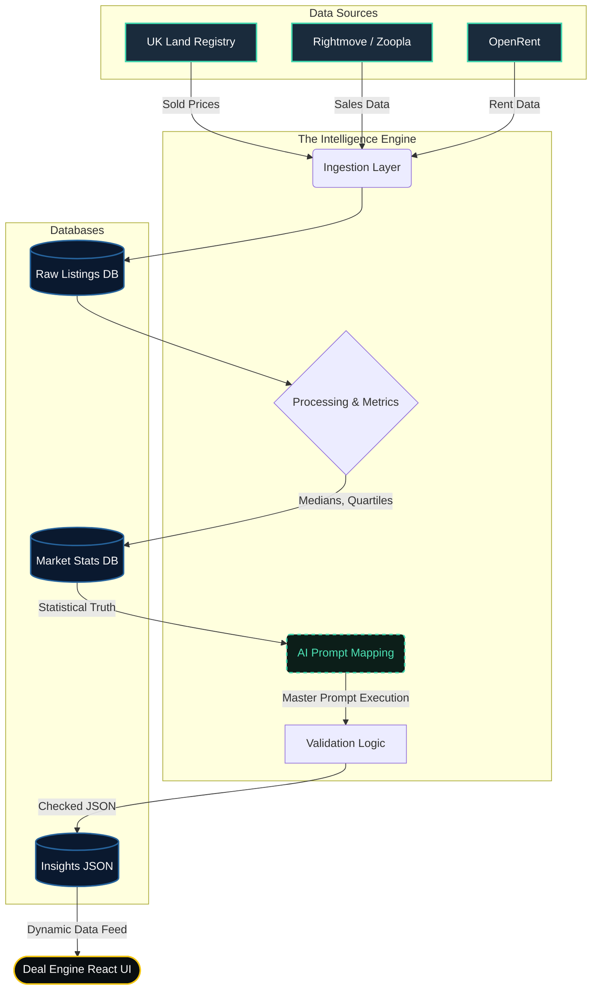

# Ayrshire Deal Engine — Live Updating Intelligence Engine

## 1. System Goal
Automatically pull fresh market data, process it into structured insights, score/validate it, update the UI cards, and track changes over time. 
**End Result:** The app always reflects the current market without manual work, creating a data moat.

## 2. System Architecture

## 3. Data Sources
- **Listings Data (Sales)**: Rightmove, Zoopla, Auctions (Price, Type, Beds, Postcode, Date)
- **Rental Data**: Rightmove, OpenRent, SpareRoom (Rent PCM, Type, Location)
- **Sold Prices (Ground Truth)**: UK Land Registry (Sold price, Date, Postcode)

## 4. Ingestion Layer
Runs on a schedule (Daily/Weekly). Fetches listings, cleans data, removes duplicates, and stores raw structural JSON.

## 5. Processing Engine (Core Logic)
1. **Group**: By Town, Property Type, Postcode Sector.
2. **Calculate**: Avg Price, Median Price, Rent Avg, Yield (Rent/Price).
3. **Detect Ranges**: Lower quartile (cheap deals), Upper quartile (top rents).
4. **Identify Opportunities**: High yield pockets (>8%), Undervalued (< median -15%), High demand (low listing duration).

## 6. AI Intelligence Layer
Feeds the structured statistical data into the Master Prompts (see `src/lib/promptSystem.js`). The AI outputs normalized insights (buy band, rent range, deal rule, risks) based on hard data rather than guesswork.

## 7. Validation Layer
Safety checks before pushing to the DB:
- Yield cap (e.g., flag if >15%)
- Rent matches real listings
- No extreme outliers
- **Confidence Scoring**: High = lots of data + tight ranges. Low = sparse/volatile data.

## 8. Database Design
- `raw_listings`: All scraped chronological data.
- `market_stats`: Statistical aggregations (medians, averages).
- `insights`: The exact shape consumed by the UI cards (AI output).
- `history`: Time-series data to track trends over time.

## 9. Update Cycle & Alerts
- **Daily**: Pull listings, update raw.
- **Weekly**: Recalculate stats, regenerate AI insights.
- **Alerts**: Triggered on yield increases, price drops, or new high-yield pockets (e.g., "KA8 yields up 1.2% this week").

## 10. Frontend Impact
UI cards become dynamic, injecting timestamps `(Updated 2 days ago)`, trend arrows 📈, and confidence badges.

## 11. Optional Auth
When `AUTH_PASSWORD` is set, sync and strategy write endpoints require a signed token. Login via `POST /api/auth/login`; token stored client-side, 24h TTL.

## 12. Strategy Builder
Visual flow editor (n8n-style) configures how `generateRealIntel` assigns strategies. Condition nodes (yield > X, buyMax > Y) branch to strategy outputs (BTL, BRRR, Flip, HMO, SA). Flows persisted to `strategy_flows.json`.

## 13. MVP Roadmap
- **Phase 1**: Manual + AI prompts (Completed)
- **Phase 2**: UK Land Registry, scrapers, strategy builder (Completed)
- **Phase 3**: Full automation pipeline, advanced AI summaries, alert triggers.
